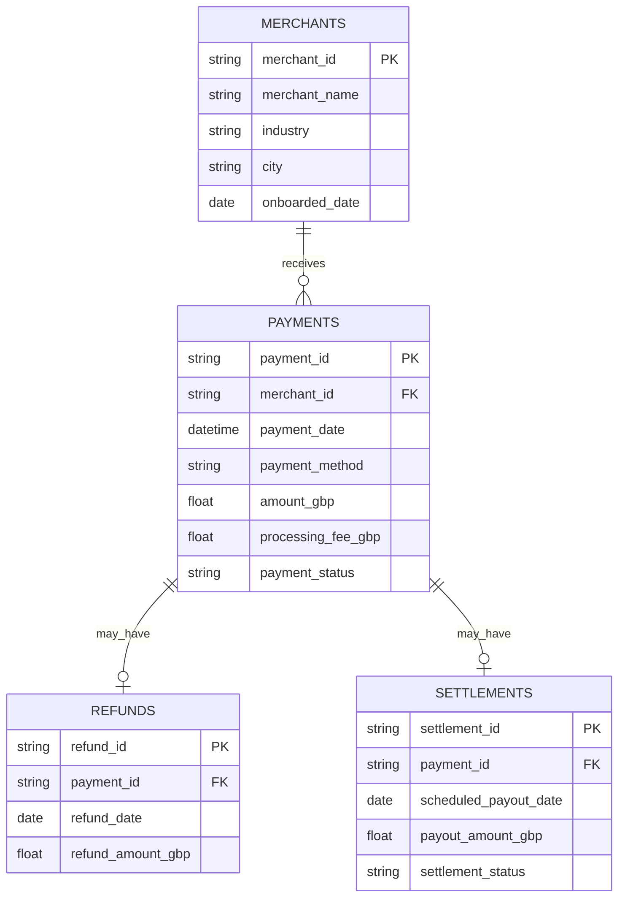

# LedgerLens — Digital Banking & SME Payments Intelligence

**A beginner-friendly, end-to-end financial analytics portfolio project** built with **Python, SQLite SQL, Pandas, Streamlit, and Plotly**. It models how a digital bank or payment processor might analyse transaction approvals, SME payment volume, refunds, processing fees, and scheduled merchant payouts.

> **Portfolio disclosure:** Every merchant, transaction and financial figure in this repository is **fictional and synthetically generated**. This project does not use live banking data, personal information, or real customer transactions. The simulated fee schedule and payment-success patterns are educational assumptions, not actual provider pricing or benchmarking.

## Dashboard at a glance

The Streamlit app has **six interactive sections**:

| Section | Business questions answered |
|---|---|
| **Overview** | How much was successfully processed? How much remains after fees and refunds? |
| **Payment performance** | Which payment methods have the highest success or failure rates? |
| **SME merchants** | Which SMEs drive net payment volume? How do their outcomes compare? |
| **Refunds & payouts** | Which industries have elevated refund *value* rates? Which payouts remain pending? |
| **SQL Lab** | Can SQL answer common banking-operations questions on the same database? |
| **Data explorer** | What do the individual attempts look like, and can an analyst export filtered results? |

**Features:** date, industry, payment-method and merchant filters; five KPI cards; interactive Plotly charts; SQL query examples with results; and downloadable CSVs.

### Illustrative results in the included seeded dataset

| Measure | Example figure |
|---|---:|
| SME merchants | 120 |
| Payment attempts | 12,000 |
| Successful attempts | 11,331 |
| Payment success rate | 94.43% |
| Gross successfully processed | £1,705,204.79 |
| Processing fees | £24,280.68 |
| Refund value | £50,280.48 |
| Net processed (gross − fees − refunds) | £1,630,643.63 |
| Pending scheduled payouts as of 30 Sep 2026 | £9,702.22 |

These are results of the *synthetic scenario*, not real-world estimates or claims of achieved business impact.

## Quick start (macOS, Windows, Linux)

**Requirements:** Python 3.10+ and a terminal. No paid API, bank account, MySQL, or Power BI is needed. SQLite is built into Python.

```bash
# 1. Download or clone this repository and enter it
cd sme-payments-intelligence

# 2. Create and activate a virtual environment
python3 -m venv .venv
source .venv/bin/activate       # macOS / Linux
# On Windows PowerShell, use: .venv\Scripts\Activate.ps1

# 3. Install required libraries
python -m pip install -r requirements.txt

# 4. Rebuild the reproducible synthetic data and SQLite database
python -m scripts.build_project

# 5. Launch the dashboard
python -m streamlit run app.py
```

Streamlit will print a local address (usually `http://localhost:8501`). Open it in your browser. To stop it, press **Ctrl+C** in the terminal.

**Already have the four CSVs?** They are included in `data/` for inspection. The generated `.sqlite` file is intentionally excluded from Git. The app will create it from the committed CSVs on first launch if needed; `python -m scripts.build_project` also regenerates all CSVs and validates the database.

### Run the tests

```bash
python -m pip install -r requirements-dev.txt
python -m pytest -q
python -m src.validate
```

The GitHub Actions workflow automatically rebuilds the database and tests the project on every push or pull request.

## Database design



- One merchant can have many payment attempts.
- Each payment attempt is either `succeeded` or `failed`.
- Only successful payments generate a settlement instruction; recent payments can be pending.
- Some successful payments have one full or partial refund; other payments have none.
- Payment/refund/settlement events are deliberately separate tables so join logic can be demonstrated.

**Data period:** 1 Oct 2025–30 Sep 2026. **As-of date:** 30 Sep 2026. **Currency:** GBP throughout.

### Financial KPI definitions

| KPI | Formula / interpretation |
|---|---|
| Gross processed | Sum of successful payment amounts |
| Payment success rate | Count of succeeded attempts / all attempts |
| Fees | Simulated processing fees on successful payments |
| Refund rate (value) | Sum of refunded GBP / successful gross GBP |
| Net processed | Gross processed − processing fees − refund value |
| Scheduled payout per payment | Successful amount − processing fee |
| Pending payouts | Sum of payout instructions with scheduled date later than the as-of date |

**Important modelling limitation:** Refunds are attributed to the **original payment date** for dashboard/cohort analysis, even when the refund happens later. Refunds are separately reported and **do not retroactively change historical settlement instructions**. Consequently, **net processed is not the same as payouts paid** and should not be called a bank-account balance or a formal cash reconciliation. In a production system, refunds, chargebacks, failed payouts, cash timing and fees would need explicit ledger entries; money should generally be stored in integer pennies rather than binary floating-point fields.

## Project structure

```text
sme-payments-intelligence/
├── app.py                        # Streamlit dashboard and filters
├── src/
│   ├── analytics.py              # Tested Pandas metrics
│   ├── config.py                 # Reproducibility and path settings
│   ├── database.py               # SQLite builder and data loader
│   ├── generate_data.py          # Deterministic synthetic dataset
│   └── validate.py               # Data integrity checks
├── scripts/
│   └── build_project.py          # One-command dataset + DB build
├── sql/
│   ├── schema.sql                # Table DDL, keys and indices
│   └── queries/                  # Six documented business queries
├── data/
│   ├── merchants.csv
│   ├── payments.csv
│   ├── refunds.csv
│   └── settlements.csv
├── tests/                         # Pipeline and financial-metric tests
├── docs/
│   ├── data_dictionary.md
│   ├── business_brief.md
│   ├── learning_path.md
│   └── github_presentation.md
├── .github/workflows/tests.yml   # GitHub Actions CI
├── .streamlit/config.toml        # Dark dashboard theme
├── requirements.txt
├── requirements-dev.txt
└── LICENSE
```

## Questions you can solve with SQL

The **SQL Lab** in the app includes six real, runnable query examples:

1. Monthly gross and net processed value.
2. Payment-method approval rates.
3. Top ten SMEs by net processed volume.
4. Industry refund rates by value.
5. Pending merchant settlements.
6. Merchants with comparatively high payment failure rates (minimum 30 attempts).

Explore the code in [`sql/queries/`](sql/queries/). Queries execute locally against SQLite, with no cloud database needed.

## What this demonstrates to recruiters

- **Python:** reproducible data generation, structured modules, and integrity checks.
- **SQL:** relational tables, primary and foreign keys, joins, grouping, conditional aggregation, `HAVING`, and query design.
- **Pandas:** filtering, `groupby`, KPI calculations, date trends and merchant segmentation.
- **Streamlit:** a multipage-style tabbed analytical dashboard with interactive filters.
- **Plotly:** visual exploration of transaction approval, volume and refunds.
- **Engineering practice:** one-command setup, deterministic synthetic data, automated tests, reproducible outputs, and GitHub CI.

A sensible CV description is: **“Built a synthetic SME payments analytics dashboard using Python, SQLite SQL, Pandas, Streamlit and Plotly; designed a four-table payments data model, automated data quality checks, and visualised payment success rates, merchant net volume, refunds and settlement pipelines.”**

Do **not** describe this as paid professional banking experience or a deployed production payment system.

## Publish to GitHub

After extracting the ZIP and entering the folder:

```bash
git init
git add .
git commit -m "Build SME payments intelligence dashboard"
git branch -M main
```

If you have GitHub CLI installed and authenticated with `gh auth login`:

```bash
gh repo create sme-payments-intelligence --public --source=. --remote=origin --push
```

Otherwise, create an **empty** public repository on [GitHub](https://github.com/new) named `sme-payments-intelligence`, then run (replace `YOUR_USERNAME`):

```bash
git remote add origin https://github.com/YOUR_USERNAME/sme-payments-intelligence.git
git push -u origin main
```

### Optional: deploy a live dashboard

On [Streamlit Community Cloud](https://share.streamlit.io/), connect your GitHub repo, select branch `main`, and choose entry file `app.py`. The app **automatically builds the SQLite database** from the included synthetic CSVs the first time it starts, so the generated database file does not have to be committed. All data is demonstrative and public. Deployment requires your own Streamlit Cloud account and internet access.

See [learning_path.md](docs/learning_path.md) when you are ready to study the project piece by piece.

## License

MIT. See [LICENSE](LICENSE).
